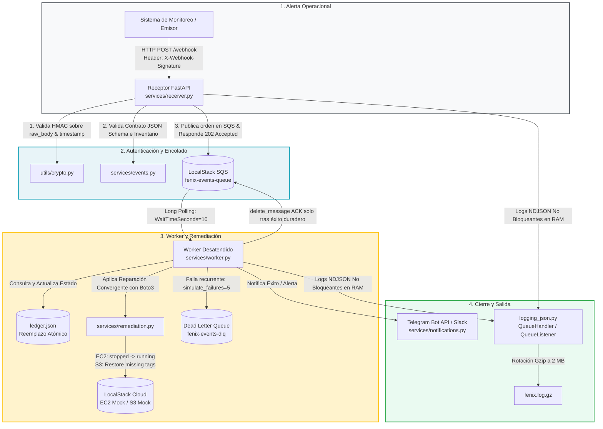

# 🦅 Proyecto Fénix: Sistema de Autorreparación de Infraestructura Cloud

Plataforma resiliente de remediación automática y convergente de infraestructura emulada en **AWS LocalStack** (`http://localhost:4566`), desarrollada en Python para la cátedra de **Programación para la Automatización II (PPA-2 / DEV6)**.

El sistema procesa alertas operacionales externas recibidas mediante **Webhooks HTTP autenticados con HMAC-SHA256**, desacopla la carga de trabajo en colas estándar de **AWS SQS** con política de reentrega a una **Dead Letter Queue (DLQ)**, y ejecuta un **Worker desatendido e idempotente** que remedia recursos cloud (EC2 y S3) usando **Boto3**, actualiza un registro de estado local atómico (`ledger.json`) y despacha notificaciones externas a **Telegram / Slack**.

[Video Defensa del Proyecto](https://ejemplo.com)

---

## 👥 Matriz de Roles y Responsabilidades del Equipo

| Integrante | Rol Técnico | Archivos / Módulos Asignados | Responsabilidad Principal |
| :--- | :--- | :--- | :--- |
| **Integrante 1** | Ingeniero de Entradas, Excepciones y Validación **Rafael Adán Cruz** | `src/fenix/utils/errors.py`<br>`src/fenix/utils/validation.py`<br>`src/fenix/services/events.py` | Jerarquía semántica `FenixError` (herencia estricta de `Exception`), validación regex de identificadores (`^[a-z0-9-]{3,32}$`), marcas ISO 8601 UTC y validación estricta del contrato JSON de eventos. |
| **Integrante 2** | Ingeniero de Mensajería e Inventario Cloud **Mauricio Jesús Goroso Romano** | `src/fenix/config/settings.py`<br>`src/fenix/services/sqs.py`<br>`src/fenix/services/demo.py` | Configuración segura de clientes Boto3 apuntando a LocalStack; creación de cola SQS y DLQ con `RedrivePolicy`; aprovisionamiento de infraestructura mock (`node-01` en EC2 y `bucket-01` en S3) y volcado de `inventory.json`. |
| **Integrante 3** | Ingeniero de Webhooks y Reparación Boto3 **Rodrigo Tarqui Gutierrez** | `src/fenix/utils/crypto.py`<br>`src/fenix/services/receiver.py`<br>`src/fenix/services/remediation.py` (`repair`) | Verificación y firma criptográfica HMAC-SHA256 sobre bytes crudos (`raw_body`) con `hmac.compare_digest()`; receptor FastAPI en `/webhook` (HTTP 202); función convergente de reparación de instancias EC2 y etiquetas S3. |
| **Integrante 4** | Ingeniero de Observabilidad y Comunicación **Javier Alejandro Quiroga** | `src/fenix/utils/logging_json.py`<br>`src/fenix/services/notifications.py` | Pipeline de logging NDJSON no bloqueante (`QueueHandler` y `QueueListener` en RAM) con rotación a 2 MB y compresión Gzip idempotente; conector externo de notificaciones (Telegram / Slack) con manejo de timeouts y backoff ante HTTP 429 (`Retry-After`). |
| **Integrante 5** | Coordinador de Integración y Worker Durable **Noemí Barragan** | `src/fenix/services/worker.py`<br>`src/fenix/services/remediation.py` (`handle`)<br>`src/fenix/cli.py`<br>`src/fenix/utils/state.py` | Bucle de consumo desacoplado con *Long Polling* SQS; actualización atómica del `ledger.json` por etapas; confirmación duradera del mensaje en SQS (`delete_message` / ACK) solo tras reparar y notificar exitosamente; orquestador de interfaz CLI con cumplimiento de PEP 765. |
| **Integrante 6** | Ingeniero de Diagnóstico, Pruebas y Caos **Ezequiel Nahuel Choque Martinez** | `tests/test_fenix.py`<br>`tests/demo/inject_fault.py` | Herramienta CLI de inyección de fallas en LocalStack (`inject_fault.py`); suite automatizada de pruebas forenses y de caos (firmas HMAC inválidas 401, cuerpos malformados 400, contrato inválido 422, fallas de red 503 y derivación a la DLQ con `simulate_failures=5`). |


---


## 📐 Diagrama de Arquitectura de la Solución




---

## 🛠️ Instalación y Configuración del Entorno

### 1. Clonar el Repositorio
```bash
git clone https://github.com/racoonar-Sla/proyecto_fenix.git
cd fenix_engine
```

### 2. Entorno Virtual Aislado (`.venv`)
* En Windows (PowerShell):
  ```powershell
  python -m venv .venv
  .venv\Scripts\Activate.ps1
  ```
* En Linux / macOS:
  ```bash
  python3 -m venv .venv
  source .venv/bin/activate
  ```

### 3. Instalar Dependencias y Modo Editable
```bash
pip install --upgrade pip
pip install -r requirements.txt
pip install -e .
```

### 4. Variables de Entorno
```powershell
Copy-Item .env.example .env
```

### 5. LocalStack con Docker
```bash
docker compose up -d
```
Verificar que los servicios requeridos (SQS, EC2 mock, S3) respondan en el puerto 4566.

---

# Documentación Técnica — Área 1: Entradas, Excepciones y Validación (Integrante 1)

**Responsable:** Rafael Adán Cruz  
**Rol:** Integrante 1 — Ingeniero de Entradas, Excepciones y Validación  
**Rama asignada:** `feature/i1-validacion` 


---

## Área 1 — Entradas, Excepciones y Validación de Esquema (Integrante 1 - Rafael Adán Cruz)

### 1. Responsabilidad y Alcance Técnico
El Área 1 constituye el **control de frontera de entrada** (*gatekeeper*) y sanitización sintáctica del Proyecto Fénix. Su responsabilidad es gobernar la jerarquía de excepciones de dominio, validar de forma estricta y determinista los tipos primitivos y marcas temporales, y hacer cumplir el contrato JSON cerrado de los eventos antes de que cualquier payload pueda interactuar con el bus de mensajería asíncrona en LocalStack SQS o con los motores de remediación.


### 2. Módulos Asignados
* `src/fenix/utils/errors.py`: Definición de la jerarquía semántica de excepciones de dominio del sistema:
  * `ProjectError` (alias `FenixError`): Clase base de la que derivan todos los errores del proyecto. Hereda estrictamente de `Exception` (nunca de `BaseException`) para preservar las señales de control del sistema operativo (`KeyboardInterrupt`, `SystemExit`).
  * `ValidationError`: Errores de sintaxis, formato, contrato de campos o tipos no conformes (asociado a HTTP 422 Unprocessable Entity).
  * `InventoryError`: Eventos dirigidos a recursos no registrados o incompatibles con el inventario del grupo.
  * `ConfigurationError`, `CommunicationError`, `TransientError`, `PermanentError`: Tipificación para control de reintentos y derivación a DLQ.
* `src/fenix/utils/validation.py`: Funciones puras de validación y normalización determinista:
  * `identifier(value)`: Valida identificadores mediante la expresión regular estricta `^[a-z0-9-]{3,32}$`. Conserva la entrada exacta sin aplicar recortes destructivos (`strip`).
  * `ttl_seconds(value)`: Valida el tiempo de vida en segundos dentro del rango operativo estricto [60, 600]. Rechaza explícitamente booleanos (`bool` como entero) y números decimales/flotantes (`float`), cumpliendo la directiva de la cátedra de no redondear entradas.
  * `utc_text(value)`: Valida marcas temporales ISO 8601 con desplazamiento estrictamente cero (`+00:00` o sufijo `Z`). Rechaza fechas naive o con husos horarios locales.
* `src/fenix/services/events.py`: Motor de validación de eventos de autorreparación:
  * `validate(event)`: Aplica el contrato JSON cerrado de exactamente 6 claves obligatorias (`schema_version`, `event_id`, `event_type`, `resource_id`, `occurred_at`, `simulate_failures`). Rechaza listas JSON en la raíz, valida la correspondencia de tipos y realiza la comprobación cruzada contra el inventario autorizado (`data/inventory.json`). Retorna una copia profunda inmutable (`copy.deepcopy`).
* `tests/test_contracts.py`: Suite oficial de pruebas unitarias parametrizadas para los contratos de frontera (`test_identifier_contract`, `test_ttl_contract`, `test_utc_contract`).

### 3. Comandos de Demostración y Verificación

#### A. Ejecución de la Suite de Contratos Automatizada
```powershell
# Ejecutar los contratos de validación de identificadores, TTL y UTC
python -m pytest tests/test_contracts.py -v

# Auditoría estática con Flake8 sobre los tres módulos asignados
flake8 src/fenix/utils/errors.py src/fenix/utils/validation.py src/fenix/services/events.py
```

#### B. Pruebas Interactivas en Terminal (1 Caso Válido y 3 Casos de Rechazo)
```powershell
# 1. Caso Válido: Evento canónico autorizado (node-01, instance.stopped, UTC)
python -c "from fenix.services.events import validate; e = {'schema_version': 1, 'event_id': 'evt-node-001', 'event_type': 'instance.stopped', 'resource_id': 'node-01', 'occurred_at': '2026-10-22T18:00:00Z', 'simulate_failures': 0}; res = validate(e); print('VALIDADO:', res['event_id'], '->', res['resource_id'])"

# 2. Rechazo 1: Lista JSON prohibida (se requiere dict único)
python -c "from fenix.services.events import validate; validate([{'schema_version': 1, 'event_id': 'evt-001'}])"

# 3. Rechazo 2: Inyección de clave no autorizada (contrato cerrado violado)
python -c "from fenix.services.events import validate; validate({'schema_version': 1, 'event_id': 'evt-node-001', 'event_type': 'instance.stopped', 'resource_id': 'node-01', 'occurred_at': '2026-10-22T18:00:00Z', 'simulate_failures': 0, 'campo_extra': 'invalido'})"

# 4. Rechazo 3: Recurso ajeno fuera del inventario autorizado
python -c "from fenix.services.events import validate; validate({'schema_version': 1, 'event_id': 'evt-node-999', 'event_type': 'instance.stopped', 'resource_id': 'node-99', 'occurred_at': '2026-10-22T18:00:00Z', 'simulate_failures': 0})"
```

#### C. Verificación de Aislamiento en LocalStack SQS
```bash
# Comprobar que tras los rechazos la cola permanece con cero mensajes
aws --endpoint-url=http://localhost:4566 sqs get-queue-attributes --queue-url http://localhost:4566/000000000000/fenix-grupo01-events --attribute-names ApproximateNumberOfMessages
```
---
