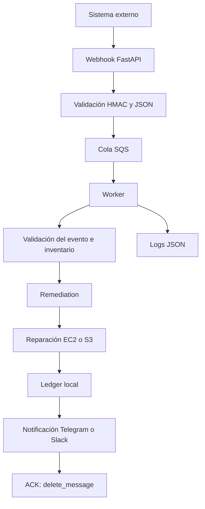

# 🦅 Proyecto Fénix: Sistema de Autorreparación de Infraestructura Cloud

## 1. Objetivo del sistema

Proyecto Fénix es un sistema desarrollado en Python para automatizar la detección y reparación de fallas en una infraestructura cloud emulada.

El sistema recibe eventos mediante Webhooks HTTP autenticados con HMAC-SHA256, los valida y los publica en colas de Amazon SQS. Luego, un Worker procesa los eventos, consulta el estado de los recursos y ejecuta las reparaciones necesarias utilizando Boto3.

El proyecto contempla dos recursos de laboratorio:

- **EC2:** una instancia detenida debe volver al estado `running`.
- **S3:** un bucket debe recuperar las etiquetas obligatorias.

Además, el sistema utiliza un registro local de estado (`ledger.json`) para guardar el progreso de cada evento y evitar repetir reparaciones o notificaciones que ya fueron completadas.

El entorno de integración previsto es AWS LocalStack. Para las pruebas locales también se utilizó Moto, una herramienta de Python que permite simular servicios de AWS.

## 2. Integrantes y responsabilidades

| Integrante | Rol | Archivos principales | Responsabilidad |
|---|---|---|---|
| Integrante 1 | Entradas, excepciones y validación | `errors.py`, `validation.py`, `events.py` | Validación de eventos y manejo de errores. |
| Integrante 2 | Mensajería e inventario Cloud | `settings.py`, `sqs.py`, `demo.py` | Configuración de clientes, colas SQS, DLQ e inventario. |
| Integrante 3 | Webhooks y reparación Boto3 | `crypto.py`, `receiver.py`, `remediation.py` (`repair`) | Autenticación HMAC, recepción HTTP y reparación de recursos. |
| Integrante 4 | Observabilidad y comunicación | `logging_json.py`, `notifications.py` | Registros JSON y envío de notificaciones. |
| Integrante 5 | Integración y Worker | `worker.py`, `remediation.py` (`handle`), `cli.py` | Procesamiento de mensajes, persistencia por etapas, ACK e interfaz CLI. |
| Integrante 6 | Diagnóstico y pruebas | `tests/`, `tests/demo/inject_fault.py` | Pruebas automatizadas e inyección de fallas. |

`src/fenix/utils/state.py` es un módulo de apoyo entregado para la lectura y escritura atómica del estado.

## 3. Arquitectura general

El flujo principal del sistema es:



El receptor HTTP valida y publica el evento. La reparación no se realiza dentro de la petición HTTP: queda a cargo del Worker, que consume los mensajes de SQS.

## 4. Tecnologías utilizadas

- **Python 3.11 o superior:** lenguaje de programación.
- **Boto3:** SDK de Python para interactuar con servicios AWS.
- **AWS LocalStack:** emulación local de servicios AWS para la integración.
- **Moto:** simulación de servicios AWS durante pruebas locales.
- **FastAPI:** receptor de Webhooks HTTP.
- **HMAC-SHA256:** autenticación e integridad de los Webhooks.
- **Amazon SQS:** cola de mensajes.
- **Dead Letter Queue (DLQ):** aislamiento de mensajes que no pudieron procesarse.
- **Pytest:** ejecución de pruebas automatizadas.
- **Docker Desktop:** ejecución del entorno LocalStack.

## 5. Requisitos previos

- Windows, Linux o macOS.
- Python 3.11 o superior.
- Git.
- Visual Studio Code u otro editor.
- Dependencias declaradas en `requirements.txt` y `requirements-lock.txt`.
- Docker Desktop y LocalStack para las pruebas de integración reales.

El proyecto no debe ejecutarse contra una cuenta real de AWS. Las credenciales de laboratorio son ficticias y el endpoint debe apuntar a LocalStack.

## 6. Instalación desde cero

### 6.1. Clonar el repositorio

```bash
git clone https://github.com/racoonar-Sla/proyecto_fenix.git
cd proyecto_fenix
```

### 6.2. Crear el entorno virtual

En Windows PowerShell:

```powershell
python -m venv .venv
.venv\Scripts\Activate.ps1
```

En Linux o macOS:

```bash
python3 -m venv .venv
source .venv/bin/activate
```

### 6.3. Instalar las dependencias

Para instalar las dependencias del proyecto:

```bash
python -m pip install --upgrade pip
python -m pip install -r requirements.txt
python -m pip install -e .
```

Para reproducir las versiones registradas en el archivo de bloqueo:

```bash
python -m pip install -r requirements-lock.txt
```

### 6.4. Configurar las variables de entorno

En Windows PowerShell:

```powershell
Copy-Item .env.example .env
```

Generar una clave segura para el Webhook:

```powershell
python -c "import secrets; print(secrets.token_urlsafe(32))"
```

Copiar el resultado en `WEBHOOK_SECRET` dentro del archivo `.env`.

Completar los datos del proveedor de notificaciones elegido únicamente si se va a utilizar Telegram o Slack.

**Importante:** el archivo `.env` contiene datos privados y no debe subirse al repositorio. Se debe utilizar `.env.example` como plantilla.

### 6.5. Configurar LocalStack

Con Docker Desktop iniciado y el archivo de configuración correspondiente:

```bash
docker compose up -d
```

La dirección local prevista es:

```text
http://localhost:4566
```

La integración real requiere verificar que los servicios necesarios respondan correctamente.

## 7. Variables de entorno

| Variable | Descripción |
|---|---|
| `AWS_ENDPOINT_URL` | Dirección del endpoint de LocalStack. |
| `AWS_ACCESS_KEY_ID` | Credencial ficticia de laboratorio. |
| `AWS_SECRET_ACCESS_KEY` | Clave ficticia de laboratorio. |
| `AWS_DEFAULT_REGION` | Región de AWS utilizada por el proyecto. |
| `GROUP_ID` | Identificador del grupo. |
| `PROJECT` | Nombre del proyecto. |
| `QUEUE_PREFIX` | Prefijo de las colas SQS. |
| `SQS_QUEUE_NAME` | Nombre de la cola principal. |
| `SQS_DLQ_NAME` | Nombre de la Dead Letter Queue. |
| `WEBHOOK_SECRET` | Clave para la autenticación HMAC. |
| `WEBHOOK_PORT` | Puerto del receptor HTTP. |
| `NOTIFY_PROVIDER` | Proveedor de notificaciones: console, telegram o slack. |
| `TELEGRAM_BOT_TOKEN` | Token del bot de Telegram. |
| `TELEGRAM_CHAT_ID` | Identificador del chat de Telegram. |
| `SLACK_WEBHOOK_URL` | Dirección del webhook de Slack. |

Los valores reales de los secretos deben configurarse localmente y nunca publicarse en GitHub.

## 8. Contrato del evento

El sistema utiliza eventos JSON con los siguientes campos obligatorios:

```json
{
  "schema_version": 1,
  "event_id": "evt-node-001",
  "event_type": "instance.stopped",
  "resource_id": "node-01",
  "occurred_at": "2026-10-22T18:00:00Z",
  "simulate_failures": 0
}
```

Los tipos de eventos previstos son:

- `instance.stopped`: indica que una instancia EC2 está detenida.
- `bucket.tags_missing`: indica que un bucket S3 perdió etiquetas obligatorias.

El identificador del recurso debe corresponder a un alias conocido en el inventario del laboratorio. No se deben aceptar identificadores arbitrarios de recursos externos.

## 9. Interfaz de línea de comandos (CLI)

La interfaz se encuentra en:

`src/fenix/cli.py`

Se implementa utilizando `argparse`, que permite organizar la ejecución mediante subcomandos.

Los comandos definidos son:

| Comando | Función |
|---|---|
| `init-queues` | Inicializa las colas SQS. |
| `setup-demo` | Prepara el entorno de demostración. |
| `fault <resource_id>` | Solicita una falla en un recurso. |
| `worker` | Inicia el Worker. |
| `worker --once` | Realiza una consulta y finaliza. |
| `send <event_file>` | Lee un evento JSON, lo valida y lo publica en SQS. |

Ejemplos:

```bash
python -m fenix.cli init-queues
python -m fenix.cli setup-demo
python -m fenix.cli fault node-01
python -m fenix.cli worker
python -m fenix.cli worker --once
python -m fenix.cli send examples/node-event.json
```

**Nota:** los comandos `setup-demo` y `fault` dependen de las implementaciones del módulo de demostración. Si todavía presentan `NotImplementedError` o indican que están pendientes, no deben considerarse operativos.

## 10. Worker y procesamiento de mensajes

El Worker es el componente encargado de consumir y procesar los eventos almacenados en SQS.

Su funcionamiento general es:

1. Consultar la cola mediante long polling.
2. Recibir el mensaje y leer su contenido JSON.
3. Validar nuevamente el evento y sus recursos.
4. Consultar el registro local para recuperar el progreso anterior.
5. Ejecutar la reparación si todavía no fue completada.
6. Guardar el resultado de la reparación.
7. Enviar la notificación si todavía está pendiente.
8. Guardar el estado de la notificación.
9. Confirmar el mensaje mediante `delete_message` solamente después de completar el procesamiento requerido.

El archivo principal es:

`src/fenix/services/worker.py`

El procesamiento por etapas se coordina desde:

`src/fenix/services/remediation.py`

### 10.1. Persistencia e idempotencia

El registro local conserva información asociada al `event_id`, incluyendo:

- `attempts`
- `repair_done`
- `repair_result`
- `notified`
- `status`

Esto permite recuperar el trabajo cuando ocurre una interrupción.

Por ejemplo, si la reparación ya se completó pero la notificación falló, el Worker debe recuperar el estado pendiente y volver a intentar la notificación sin repetir una reparación que ya fue confirmada.

La persistencia local ayuda a evitar efectos repetidos, pero no convierte las operaciones externas y el archivo JSON en una única transacción. Por eso no se promete una entrega exactamente una vez.

### 10.2. ACK y reintentos

El ACK se realiza con `delete_message` utilizando el `ReceiptHandle` correspondiente a la recepción actual.

Si el procesamiento falla, el mensaje debe conservarse para permitir un nuevo intento. La política `RedrivePolicy` de SQS es la encargada de derivar los mensajes persistentes a la DLQ cuando se supera el límite de recepciones configurado.

No se debe publicar un mensaje nuevo para simular un reintento ni eliminar un mensaje fallido para ocultar el error.

## 11. Pruebas realizadas

Las siguientes pruebas se ejecutaron durante el desarrollo local del proyecto.

| Prueba | Comando o procedimiento | Resultado observado |
|---|---|---|
| Reanudación después de una falla de notificación | `python prueba_reanudacion.py` | Aprobada con mocks. La reparación se ejecutó una vez y luego se completó la notificación pendiente. |
| Publicación, recepción y ACK con Moto | `python test_moto_fenix.py` | Aprobada. Se confirmó la publicación, recepción y eliminación del mensaje en el entorno simulado. |
| Pruebas automáticas seleccionadas | `python -m pytest -m "not pendiente and not integracion" -v` | 5 aprobadas y 7 excluidas por los marcadores. |

### 11.1. Detalle de las pruebas automáticas

Resultado observado:

```text
5 passed, 7 deselected
```

Pruebas aprobadas:

- `test_moto_fenix.py::test_sqs_with_moto`
- `tests/test_base.py::test_state_survives_restart`
- `tests/test_base.py::test_corrupt_state_is_not_empty`
- `tests/test_base.py::test_delay_is_bounded`
- `tests/test_base.py::test_json_log_context`

Las siete pruebas excluidas no deben considerarse aprobadas. Se excluyeron por utilizar los marcadores `pendiente` o `integracion`.

### 11.2. Alcance de las pruebas

Moto permite simular servicios de AWS para probar el código localmente. Sin embargo, sus resultados no sustituyen una prueba de integración real con LocalStack.

Las pruebas de reanudación realizadas con mocks demuestran el comportamiento del código bajo esas condiciones controladas, pero no demuestran por sí solas una interrupción real de SQS o una derivación efectiva a la DLQ.

## 12. Matriz de pruebas pendientes de integración

La siguiente tabla identifica pruebas de la consigna que todavía requieren evidencia específica.

| ID | Caso | Estado de evidencia |
|---|---|---|
| F01 | Inicializar colas y preparar el laboratorio dos veces sin duplicados | Pendiente de integración LocalStack. |
| F02 | Reparar una instancia detenida y verificar su estado mediante Boto3 | Pendiente de integración LocalStack. |
| F03 | Recuperar etiquetas obligatorias de un bucket S3 | Pendiente de integración LocalStack. |
| F04 | Rechazar firmas ausentes, alteradas o vencidas | Pendiente de evidencia específica. |
| F05 | Rechazar HMAC inválida con bytes diferentes | Pendiente de evidencia específica. |
| F06 | Rechazar JSON roto y contrato incorrecto | Pendiente de evidencia específica. |
| F07 | Rechazar alias ajeno y claves extra | Pendiente de evidencia específica. |
| F08 | Enviar JSON corrupto directamente a SQS y verificar su tratamiento | Pendiente de integración LocalStack. |
| F09 | Simular fallas temporales y verificar la recuperación | Pendiente de evidencia completa. |
| F10 | Verificar la derivación de un mensaje persistente a la DLQ | Pendiente de integración LocalStack. |
| F11 | Repetir un evento completo y reiniciar el Worker | Pendiente de evidencia completa. |
| F12 | Interrumpir después de reparar y antes de notificar | Reanudación simulada aprobada; falta evidencia de integración real. |
| F13 | Verificar el comportamiento cuando SQS no está disponible | Pendiente de integración LocalStack. |
| F14 | Simular fallas 429 o timeout de notificación | Pendiente de evidencia específica. |
| F15 | Cambiar el contenido manteniendo el mismo `event_id` | Pendiente de evidencia específica. |
| F16 | Verificar rotación, compresión Gzip y contenido de los logs | Pendiente de evidencia específica. |

## 13. Limitaciones conocidas

Durante las pruebas locales se presentaron dificultades para iniciar Docker y conectar con LocalStack en el endpoint `http://localhost:4566`.

Por las limitaciones del equipo utilizado, se continuó con pruebas locales mediante Moto y mocks.

Esto permitió comprobar partes del procesamiento de mensajes, la persistencia y la reanudación, pero no reemplaza las pruebas de integración exigidas por la consigna.

Quedan pendientes de completar o demostrar:

- Integración real con LocalStack.
- Creación y verificación de recursos EC2 y S3 mediante Boto3.
- Funcionamiento real de SQS y su DLQ.
- Envío real de una notificación por Telegram o Slack.
- Evidencias de logs nominales, logs de fallo e histórico Gzip.
- Consulta final del estado de los recursos mediante Boto3.

Estas limitaciones deben revisarse con el equipo y la cátedra antes de la entrega final.

## 14. Evidencias

Las evidencias del proyecto deben guardarse en una carpeta `evidencias/`.

Se recomienda incluir:

- Resultado de las pruebas automáticas.
- Resultado de la prueba de reanudación.
- Resultado de la prueba de SQS con Moto.
- Capturas del Worker y del flujo de ACK.
- Capturas de la función `handle`.
- Evidencias reales de integración LocalStack cuando estén disponibles.
- Logs anonimizados y resultados de las pruebas de notificación.

Las capturas deben corresponder a ejecuciones reales. No se deben presentar resultados simulados como si fueran pruebas de integración.

## 15. Limpieza del laboratorio

Antes de eliminar recursos:

1. Detener el Worker y los procesos del receptor.
2. Revisar el inventario del grupo.
3. Identificar los recursos creados por el proyecto.
4. Eliminar únicamente los recursos propios del laboratorio.
5. Documentar la DLQ antes de destruir las colas.
6. Conservar las evidencias necesarias para la entrega.

No se debe borrar el inventario mientras existan recursos que dependan de sus identificadores.

## 16. Video de defensa

**Enlace al video:** pendiente de agregar.

Cada integrante debe incluir su intervención y explicar su responsabilidad, las decisiones técnicas y las pruebas correspondientes.

## 17. Uso de herramientas de apoyo e inteligencia artificial

Se utilizaron herramientas de asistencia basadas en inteligencia artificial como apoyo para comprender conceptos, revisar código, organizar documentación y resolver errores durante el desarrollo.

Las implementaciones fueron ejecutadas y verificadas mediante las pruebas disponibles. Cada integrante debe poder explicar y defender el código correspondiente a su responsabilidad.

## 18. Reproducción por otro integrante

Para comprobar que el proyecto puede reproducirse, otro integrante debe:

1. Clonar el repositorio en una carpeta nueva.
2. Crear su propio entorno virtual.
3. Instalar las dependencias.
4. Configurar un archivo `.env` propio a partir de `.env.example`.
5. Ejecutar las pruebas documentadas.
6. Registrar cualquier instrucción que necesite corrección.

La documentación debe actualizarse si durante esta revisión se detectan diferencias entre los comandos indicados y el funcionamiento real del proyecto.
